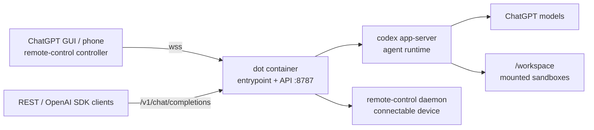

<p align="center">
  
</p>

<h1 align="center">dot</h1>

<p align="center">
  Give ChatGPT / Dot (<b>"Your computer"</b> and <b>Codex remote control</b>) a clean, isolated container workspace on your PC or on a headless Linux server — plus a local HTTP bridge for health checks, pairing, and sandbox orchestration.
</p>

> [!IMPORTANT]
> **Disclaimer — Intended Use & Terms**
>
> - **Why this exists:** This project is built solely to expose a **clean,
>   container-isolated computer environment** (or a headless Linux server
>   without an Electron GUI) to your own ChatGPT / Dot agent, so the agent can
>   work inside a dedicated `/workspace` instead of having unrestricted access
>   to your host's home directory, SSH keys, and browser profiles.
> - **No modified binaries, no paywall bypass:** `dot` ships zero proprietary
>   code. It installs and orchestrates the official, unmodified
>   [OpenAI Codex CLI](https://github.com/openai/codex) (`codex`, Apache-2.0)
>   and requires your own authenticated ChatGPT account (or `OPENAI_API_KEY`).
>   It is **not** intended to be used as a general-purpose API proxy or to
>   bypass API billing for third-party applications.
> - **Unofficial project:** `dot` is an independent open-source project and is
>   not affiliated with, endorsed by, or supported by OpenAI. "ChatGPT" and
>   "Codex" are trademarks of their respective owners.
> - **Use at your own risk:** The optional Dots local-computer connector
>   (`DOT_DOTS_EXECUTOR=1`) and environment status lookup use undocumented
>   backend endpoints that may change or stop working at any time. You are
>   responsible for complying with the terms applicable to your account and for
>   securing the directories you mount into `/workspace` (see [Security](#security)).

## Architecture



Two cooperating processes share one `CODEX_HOME`:

1. `codex remote-control start`: keeps the device enrolled and reachable.
2. `node /app/server.js`: a zero-dependency HTTP bridge that owns a long-lived
   `codex app-server` child and translates chat requests into turns.

## Quick start

Requirements: Docker with Compose v2, and a ChatGPT account.

```bash
git clone <this repository> dot && cd dot/docker
cp .env.example .env            # optional: edit
docker compose up -d --build
docker compose logs -f dot
```

The Compose file mounts `${HOME}/.codex/auth.json` read-only as a one-time
auth seed and copies it into the `dot-data` volume if non-empty. If you do not
have an `auth.json` yet, create an empty placeholder file before the first
start so Docker does not mount a directory (`mkdir -p ~/.codex && touch ~/.codex/auth.json`);
the container then runs device login, prints a ChatGPT URL and one-time code in
the logs, and connects automatically once you confirm.

The API is published on `127.0.0.1:8787` only. Check it:

```bash
curl -s localhost:8787/health | jq
```

On hosts that cannot create Docker bridge interfaces (nested/restricted
Docker), use host networking:

```bash
docker compose -f docker-compose.yml -f docker-compose.host-network.yml up -d --build
```

## Building your own image

Everything is built from this repository plus the official Codex installer.

```bash
# Build (CODEX_VERSION pins the Codex CLI release baked into the image)
docker build -t dot:local --build-arg CODEX_VERSION=0.167.0 docker

# Run
docker run -d --name dot --hostname dot-sandbox --init \
  -p 127.0.0.1:8787:8787 -e DOT_BIND=0.0.0.0 \
  -v dot-data:/data \
  -v "$PWD/workspace:/workspace" \
  -v "$HOME/.codex/auth.json:/seed/auth.json:ro" \
  dot:local
```

Notes:

- The Dockerfile downloads `https://chatgpt.com/codex/install.sh` at build time.
  Review it if you need supply-chain guarantees, or vendor your own Codex
  package and adapt the `RUN` step.
- Build behind a restricted network: add `--network=host` to `docker build`.
- Push to your own registry:

  ```bash
  docker tag dot:local registry.example.com/you/dot:0.1.0
  docker push registry.example.com/you/dot:0.1.0
  ```

- Compose builds from the same Dockerfile; set `DOT_IMAGE` to name the result.
- Multi-arch images: `docker buildx build --platform linux/amd64,linux/arm64 ...`
  (the Codex installer selects the matching binary).

## Make it visible in ChatGPT

1. **Container is online.** `GET /v1/remote/environments` returns the
   container's own record with `"online": true`.
2. **Pair a controller (optional).** Generate a short code:

   ```bash
   curl -s -X POST localhost:8787/v1/remote/pair | jq
   # { "manualPairingCode": "F9N5-PKB2", ... }
   ```

   Enter it in the ChatGPT GUI's device-pairing flow.
3. **Name.** The visible name is the container hostname. Set `DOT_HOSTNAME`
   (Compose) or `--hostname` (`docker run`) before first enrollment.

## Chat API

```bash
curl -s localhost:8787/v1/chat/completions \
  -H 'Content-Type: application/json' \
  -d '{
    "conversation_id": "build",
    "messages": [
      {"role": "system", "content": "You are a terse coding agent."},
      {"role": "user", "content": "List the files in /workspace and stop."}
    ]
  }' | jq -r '.choices[0].message.content'
```

Streaming: add `"stream": true` and use `curl -N`. Simple helper:
`POST /v1/chat` with `{"conversation_id": "...", "messages": [...]}` returns
`{reply, thread_id, conversation_id}`.

`conversation_id` (also `metadata.conversation_id`, `x-conversation-id`, or
`user`) maps to a persistent thread; later requests reuse its history and only
the newest user message is sent per turn. Without any identifier each request
gets its own conversation (streaming responses expose it via the
`X-Conversation-Id` header). A system/developer message applies when the
thread is created; explicitly changing `model`, `cwd` or instructions on an
existing conversation returns `409` — use a new `conversation_id`. `cwd` must
be inside `/workspace`. Only text content parts are accepted. Request bodies
must be `application/json`.

| Method | Path | Purpose |
|---|---|---|
| `GET` | `/livez` | Liveness: HTTP process serves requests (no auth required) |
| `GET` | `/readyz` | Readiness: initialized app-server + auth configuration; 503 otherwise |
| `GET` | `/health` | Diagnostics: Codex version, auth, remote state, readiness |
| `GET` | `/v1/models` | Minimal model list |
| `POST` | `/v1/chat/completions` | OpenAI chat completions (stream or JSON) |
| `POST` | `/v1/chat` | `{reply, thread_id, conversation_id}` |
| `POST` | `/v1/interrupt` | `{thread_id}` interrupts the active turn; responds after the turn ends |
| `POST`/`GET` | `/v1/remote/pair` | Manual pairing code |
| `GET` | `/v1/remote/environments` | Environment list plus `self` |

## Configuration

| Variable | Default | Meaning |
|---|---|---|
| `CODEX_VERSION` | `0.167.0` | Codex CLI release pinned at build time |
| `DOT_IMAGE` | `dot:local` | Image name used by Compose |
| `DOT_HOSTNAME` | `dot-sandbox` | Container hostname → visible device name |
| `DOT_PORT` | `8787` | Host API port |
| `DOT_BIND` | `127.0.0.1` | API bind address (Compose sets `0.0.0.0` inside the container; the port is published on loopback only) |
| `DOT_WORKSPACE_HOST` | `./workspace` | Host directory mounted at `/workspace` |
| `DOT_AUTH_FILE` | `${HOME}/.codex/auth.json` | Host auth seed file |
| `DOT_DEVICE_LOGIN` | `1` | Start device-code login when no auth exists |
| `DOT_MODEL` | app default | Model passed to `thread/start` |
| `DOT_SANDBOX` | `danger-full-access` | App-server sandbox mode inside the container |
| `DOT_APPROVAL_POLICY` | `never` | App-server approval policy |
| `DOT_THREAD_MODE` | `persistent` | `persistent` or `ephemeral` threads |
| `DOT_API_KEY` | empty | Bearer token required on every endpoint except `/health`, `/livez`, `/readyz` |
| `DOT_CORS_ORIGINS` | empty | Comma-separated allowed browser origins; `*` only works with `DOT_API_KEY` |
| `DOT_ANALYTICS` | `0` | Pass `--analytics-default-enabled` to the app-server |
| `DOT_TURN_TIMEOUT_MS` | `600000` | Per-turn timeout |
| `DOT_DOTS_EXECUTOR` | `0` | Experimental Dots connector, see [docs/dots-executor.md](docs/dots-executor.md) |

## Several sandboxes

Run one container per sandbox with distinct names, ports and **separate data
volumes**; each gets its own `installation_id` and device:

```bash
docker run -d --name dot-a --hostname dot-a --network host -e DOT_API_PORT=8787 \
  -v dot-a:/data -v ~/src/a:/workspace -v ~/.codex/auth.json:/seed/auth.json:ro dot:local
docker run -d --name dot-b --hostname dot-b --network host -e DOT_API_PORT=8788 \
  -v dot-b:/data -v ~/src/b:/workspace -v ~/.codex/auth.json:/seed/auth.json:ro dot:local
```

## Security

The API grants an agent shell access to `/workspace`. Treat it as a
remote-code-execution endpoint. See [SECURITY.md](SECURITY.md).

- Loopback only by default. Without `DOT_API_KEY`, non-loopback `Host` headers
  and cross-origin browser requests are rejected. Set `DOT_API_KEY` before
  exposing the API anywhere else.
- Mount only directories the agent should touch; never the Docker socket, SSH
  keys, or your home directory.
- `danger-full-access` relies on the container as the boundary.
- `/data` contains ChatGPT tokens. Keep the volume private.

## Troubleshooting

- **`remote.connected: false` on first boot.** The first enrollment can race
  the auth copy; the remote-control worker retries every 30 s. Look for
  `[remote-control] status: {...}` in `docker logs dot`. `connected: true`
  additionally requires a status check within the last 90 s; an old check is
  reported as `stale`.
- **`connecting`/`errored` with a reused volume.** The `installation_id` is
  already online elsewhere. Remove the volume (`docker compose down -v`).
- **`failed to add the host <=> sandbox pair interfaces`.** Docker cannot
  create bridges; use the host-network override above and
  `docker build --network=host`.
- **Chat returns 401 / app-server errors.** The auth seed was not copied or
  the device login did not finish. Check `/health` and `/data/codex/login.log`.
- **Device not visible in ChatGPT.** Confirm `online` in
  `GET /v1/remote/environments`; re-pair with `/v1/remote/pair`.

## Kubernetes

Generic manifests live in `deploy/base` (Kustomize). Create the prerequisites
in your namespace, then apply an overlay:

```bash
kubectl create namespace dot
kubectl -n dot create secret generic dot-auth --from-file=auth.json=$HOME/.codex/auth.json
kubectl -n dot create secret generic dot-api-key --from-literal=key="$(openssl rand -hex 32)"

cp -r deploy/overlays/example deploy/overlays/mine   # set image, storage class, ...
kubectl apply -k deploy/overlays/mine
kubectl -n dot port-forward svc/dot 8787:8787
```

`DOT_API_KEY` is mandatory in the cluster (the Service is ClusterIP-only and
probes use non-loopback Host headers). Run exactly one replica per data volume.

## CI and releases

Development happens on the primary Forgejo repository. The GitHub repository is
a read-only mirror and runs no workflows. [`.forgejo/workflows/ci.yml`](.forgejo/workflows/ci.yml)
runs lint and the offline suite on Node 22 and 24, tests the deployment
renderer, builds the image, qualifies the built image offline
(`docker/verify-image.sh`, no network), and only then pushes and — if
configured — deploys from `main` using the exact registry digest
(`deploy/render.py` renders one fully determined manifest set; a single
`kubectl apply`, no after-the-fact image patch):

| Setting | Kind | Purpose |
|---|---|---|
| `REGISTRY` | variable | Registry host; unset means build without pushing |
| `REGISTRY_USER` / `REGISTRY_TOKEN` | variable / secret | Registry login |
| `DEPLOY_NAMESPACE` | variable | Namespace for the deploy job |
| `KUBE_CONFIG` | secret | Kubeconfig for the deploy job |
| `DEPLOY_KUSTOMIZATION` | secret | Content of a private overlay `kustomization.yaml` (namespace, image, storage, node placement) |
| `GITHUB_MIRROR_REPO` | variable | GitHub mirror target (`owner/dot` or `https://github.com/owner/dot.git`) |
| `GITHUB_MIRROR_TOKEN` | secret | GitHub PAT (`Contents: Read and write`) used to push `main` and tags on `main` pushes |

The deploy job is skipped when any of these are missing. The `image` job
mounts a Podman socket path specific to the original runner; adjust the
`options:` line for your runner.

## Development

```bash
cd docker
npm run lint
npm test               # full offline gate: fake codex, no network or auth
npm run test:unit      # helper/validation logic only
npm run test:bridge    # JSON-RPC, chat, SSE, queue, abort, restart, probes
npm run test:supervisor # runtime seeding, auth seed, process supervision

# Qualify an actually built image (requires a Docker daemon):
docker build -t dot:reliability .
DOT_TEST_IMAGE=dot:reliability npm run test:image

# Deployment rendering (from the repo root; needs kubectl + PyYAML):
python3 -m unittest discover -s deploy -p test_render.py
```

See [CONTRIBUTING.md](CONTRIBUTING.md).

## Layout

```
docker/
  Dockerfile                    # node bookworm + official standalone Codex package
  entrypoint.sh                 # runtime seeding, auth, bounded supervision
  remote-control.sh             # enrollment worker (atomic status + checkedAt)
  server.js                     # zero-dependency HTTP <-> app-server bridge
  dots-executor.sh              # experimental Dots connector
  verify-image.sh               # offline qualification of a built image
  docker-compose.yml            # bridge networking, loopback port
  docker-compose.host-network.yml
  test/                         # node:test suites + fake codex + image smoke
deploy/
  base/                         # generic Kustomize base
  overlays/example/             # template overlay
  render.py                     # digest-pinned manifest renderer
  test_render.py                # renderer tests (kubectl kustomize, no cluster)
docs/
  protocol.md                   # how dot uses the Codex CLI
  dots-executor.md              # experimental connector
```

## License

[Apache-2.0](LICENSE)
