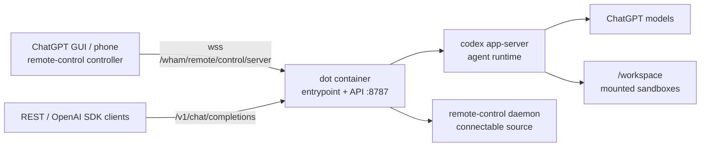

# dot

Run the ChatGPT/Codex desktop app's agent runtime (`codex` app-server) in a
Docker container, expose it as an OpenAI-compatible chat API, and enroll the
container as a **connectable source** in the ChatGPT GUI through Codex remote
control.

The reverse-engineering evidence is in
[`docs/re-findings.md`](docs/re-findings.md). Runtime facts this project relies
on:

- `codex remote-control start --json` enrolls the host and returns
  `{"status":"connected","serverName":…,"environmentId":…}`.
- The enrolled host appears online in
  `https://chatgpt.com/backend-api/wham/remote/control/environments` with its
  `installation_id`, `client_type: CODEX_CLI`, and `originator:
  codex_cli_rs`. This is the record the ChatGPT GUI renders as a device.
- `codex app-server --listen stdio://` accepts newline-delimited JSON-RPC:
  `thread/start` → `turn/start` → `item/agentMessage/delta` →
  `turn/completed`.
- `codex remote-control pair --json` returns a short manual pairing code for a
  controller (phone/desktop GUI) to pair with the container.

## Architecture



The container runs two cooperating processes with one `CODEX_HOME`:

1. `codex remote-control start` — the daemon that keeps the device enrolled
   and reachable from the ChatGPT GUI.
2. `node /app/server.js` — a zero-dependency HTTP bridge that owns a
   long-lived `codex app-server` child and translates chat requests into
   app-server turns.

## Quick start

```bash
cd docker

# Optional: pick a model and a workspace on the host.
export DOT_MODEL=gpt-6.1-sol
export DOT_WORKSPACE_HOST="$HOME/src"

docker compose up -d --build
docker compose logs -f dot
```

The compose file mounts `${HOME}/.codex/auth.json` read-only as an auth seed.
The entrypoint copies it into the `dot-data` volume on first start, so token
refreshes do not modify the host file.

This workstation rejects Docker bridge/veth creation, so the compose service
uses `network_mode: host` and the API binds `127.0.0.1:${DOT_PORT}` directly.
On a host with working bridge networking, replace `network_mode: host` with a
port mapping if you prefer:

```yaml
    ports:
      - "${DOT_PORT:-8787}:8787"
    environment:
      DOT_BIND: 0.0.0.0
```

If you have no host `auth.json`, leave the mount alone; the container prints a
ChatGPT device-login URL and one-time code in `docker compose logs -f dot`.
Open the URL, enter the code, and the entrypoint will connect remote control on
the next retry.

Check status:

```bash
curl -s localhost:8787/health | jq
```

Expected after login:

```json
{
  "ok": true,
  "auth": { "loggedIn": true, "authMode": "chatgpt", "accountIdPresent": true },
  "remote": {
    "connected": true,
    "status": "connected",
    "serverName": "dot-sandbox",
    "environmentId": "env_e_…",
    "installationId": "…"
  }
}
```

## Make it visible in ChatGPT

1. **Container is online.** `GET /v1/remote/environments` returns the
   container's own record with `"online": true`. That is the same data the
   ChatGPT GUI reads for its connectable-source list.
2. **Pair a controller (optional).** Generate a short code:

   ```bash
   curl -s -X POST localhost:8787/v1/remote/pair | jq
   # { "manualPairingCode": "F9N5-PKB2", ... }
   ```

   Enter that code in the ChatGPT GUI's "connect a device / add computer"
   flow. The container's `environmentId` is the device it pairs with.
3. **Select the device in ChatGPT.** The environment name comes from the
   container hostname. Set `DOT_HOSTNAME=my-sandbox` (compose) or
   `--hostname my-sandbox` (`docker run`) before first enrollment to control
   the visible name.

To confirm from the API without the GUI:

```bash
curl -s localhost:8787/v1/remote/environments \
  | jq '.self | {display_name, online, os, app_server_version, last_seen_at}'
```

## Chat API

### OpenAI-compatible, non-streaming

```bash
curl -s localhost:8787/v1/chat/completions \
  -H 'Content-Type: application/json' \
  -d '{
    "conversation_id": "build",
    "messages": [
      {"role": "system", "content": "You are a terse coding agent."},
      {"role": "user", "content": "List the files in /workspace and stop."}
    ]
  }' | jq -r '.choices[0].message.content'
```

### Streaming (SSE)

```bash
curl -N localhost:8787/v1/chat/completions \
  -H 'Content-Type: application/json' \
  -d '{"stream": true, "messages": [{"role": "user", "content": "Say hello"}]}'
```

### Simple helper

```bash
curl -s -X POST localhost:8787/v1/chat \
  -H 'Content-Type: application/json' \
  -d '{"conversation_id": "build", "messages": [{"role": "user", "content": "Status?"}]}' \
  | jq -r '.reply'
```

`conversation_id` (also accepted as `metadata.conversation_id`,
`x-conversation-id`, or `user`) maps to a persistent app-server thread. Later
requests with the same id reuse the thread and its history; only the newest
user message is sent per turn. A system/developer message is applied when the
thread is created. Set `cwd` to a directory inside `/workspace` to run a turn
against a specific project. Only text content parts are accepted.

### Other endpoints

| Method | Path | Purpose |
|---|---|---|
| `GET` | `/health` | Codex version, auth state, remote-control state |
| `GET` | `/v1/models` | Minimal model list |
| `POST` | `/v1/chat/completions` | OpenAI chat completions (stream or JSON) |
| `POST` | `/v1/chat` | `{reply, thread_id, conversation_id}` |
| `POST` | `/v1/interrupt` | `{thread_id}` interrupts the active turn |
| `POST`/`GET` | `/v1/remote/pair` | Manual pairing code |
| `GET` | `/v1/remote/environments` | GUI-visible environment list + `self` |

Set `DOT_API_KEY` to require `Authorization: Bearer <key>` on every endpoint
except `/health`.

## Sandbox integration

The container is the isolation boundary. Give it the directories the agent
should orchestrate:

```yaml
volumes:
  - /home/me/src/project-a:/workspace
```

For several independent sandboxes, run one container per sandbox with distinct
names and ports; each gets its own `installation_id` and therefore its own
connectable source:

```bash
docker run -d --name dot-a --hostname dot-a --network host \
  -e DOT_API_PORT=8787 \
  -v dot-a:/data -v ~/src/a:/workspace \
  -v ~/.codex/auth.json:/seed/auth.json:ro dot-dot:latest

docker run -d --name dot-b --hostname dot-b --network host \
  -e DOT_API_PORT=8788 \
  -v dot-b:/data -v ~/src/b:/workspace \
  -v ~/.codex/auth.json:/seed/auth.json:ro dot-dot:latest
```

Never reuse a `/data` volume between containers: a duplicated
`installation_id` collides with the already-online device and remote control
stays in `connecting`/`errored`.

## Configuration

| Variable | Default | Meaning |
|---|---|---|
| `CODEX_VERSION` | `0.167.0` | Official standalone package pinned at build |
| `DOT_HOSTNAME` | `dot-sandbox` | Container hostname → visible device name |
| `DOT_PORT` | `8787` | Host API port (host networking) |
| `DOT_BIND` | `127.0.0.1` | API bind address; set `0.0.0.0` only with a port mapping **and** `DOT_API_KEY` |
| `DOT_WORKSPACE_HOST` | `./workspace` | Host directory mounted at `/workspace` |
| `DOT_AUTH_FILE` | `${HOME}/.codex/auth.json` | Host auth seed file |
| `DOT_DEVICE_LOGIN` | `1` | Start device-code login when no auth exists |
| `DOT_MODEL` | app default | Model passed to `thread/start` |
| `DOT_SANDBOX` | `danger-full-access` | App-server sandbox mode inside container |
| `DOT_APPROVAL_POLICY` | `never` | App-server approval policy |
| `DOT_THREAD_MODE` | `persistent` | `persistent` or `ephemeral` threads |
| `DOT_API_KEY` | empty | Bearer token required by the API |
| `DOT_TURN_TIMEOUT_MS` | `600000` | Per-turn timeout |

## Security

The API grants an agent shell access to `/workspace` with the configured
sandbox. Treat it as a remote-code-execution endpoint:

- The API binds `127.0.0.1` by default. Keep it loopback-only unless you set
  `DOT_API_KEY`; set `DOT_BIND=0.0.0.0` only when a bridge/port mapping
  requires it, and never expose it without the key.
- Mount only directories the agent should touch.
- The default `danger-full-access` is scoped by the container; do not mount
  the Docker socket, SSH keys, or the whole home directory.
- `auth.json` in the volume contains ChatGPT tokens. Keep the volume private.

## Troubleshooting

- **`remote.connected: false` on first boot.** The first `remote-control
  start` can race the auth copy; the entrypoint retries immediately and every
  30 seconds. Check `docker logs dot` for `remote control: {"status":...}`.
- **`status: connecting` or `errored` with a reused volume.** The
  `installation_id` is already online in another container. Remove the volume
  and start fresh (`docker compose down -v`).
- **Build fails with `failed to add the host <=> sandbox pair interfaces`.**
  The host cannot create Docker bridge interfaces (nested/restricted Docker).
  The compose file already builds with `network: host` and runs with
  `network_mode: host`. For a raw `docker build`, add `--network=host`; for
  `docker run`, use `--network host` with `-e DOT_API_PORT=…` instead of `-p`.
- **Chat returns 401/`app-server` errors.** The auth seed was not copied or
  the device login did not complete. Check `/health` and
  `/data/codex/login.log` in the volume.
- **GUI does not show the device.** Confirm the environment is `online` in
  `GET /v1/remote/environments`; the GUI reads the same backend record.
  Re-pair a controller with `/v1/remote/pair` if needed.

## Kubernetes (k3s)

`main` is production: a push builds and pushes
`registry.ericvogt.com/root/dot:<sha>`, then applies `deploy/k8s.yaml` and
updates the `apps/dot` Deployment. `development` runs the same checks and image
build without deploying. Both branches are protected against deletion.

One-time cluster prerequisites (already created in `apps`):

- `Secret/dot-auth` — seed `auth.json`.
- `Secret/dot-api-key` — bearer token required by the API.
- `Secret/forgejo-registry` — image pull secret for `registry.ericvogt.com`.
- `ServiceAccount/dot-deployer` + Role/RoleBinding — CI can manage only
  Deployments, Services, PVCs, ConfigMaps and Pods in `apps`.

The pod is pinned to node `thinkstation-k3s` (ts3), uses local-path PVCs
`dot-data-ts` and `dot-workspace-ts`, and sets `hostname: dot-k3s` (the ChatGPT
device name). The
API is ClusterIP-only; use port-forward:

```bash
kubectl -n apps port-forward svc/dot 8787:8787
kubectl -n apps get secret dot-api-key -o jsonpath='{.data.key}' | base64 -d
curl -s localhost:8787/health
```

Forgejo repository secrets: `REGISTRY_TOKEN`, `KUBE_CONFIG`; variable:
`REGISTRY_USER=root`.

## Layout

```
docker/
  Dockerfile          # node bookworm + official standalone Codex package
  entrypoint.sh       # seed, auth, remote control, API supervisor
  server.js           # zero-dependency HTTP ↔ app-server bridge
  docker-compose.yml
deploy/
  k8s.yaml            # k3s Deployment/Service/PVCs (apps namespace)
.forgejo/workflows/
  ci.yml              # test, build/push, deploy on main
docs/re-findings.md   # Hopper/app.asar evidence and protocol notes
data/                 # extracted ChatGPT desktop .deb (analysis input, not committed)
```
